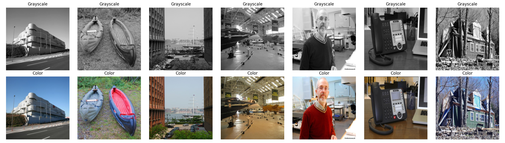
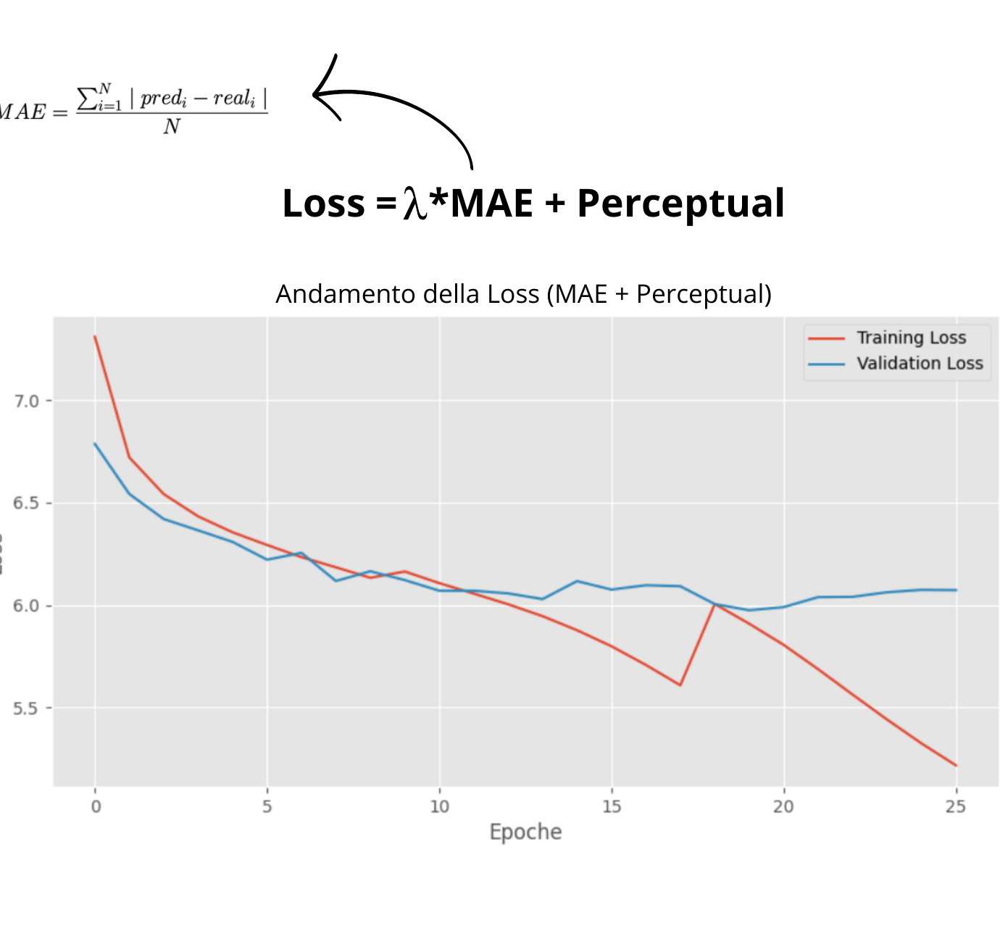
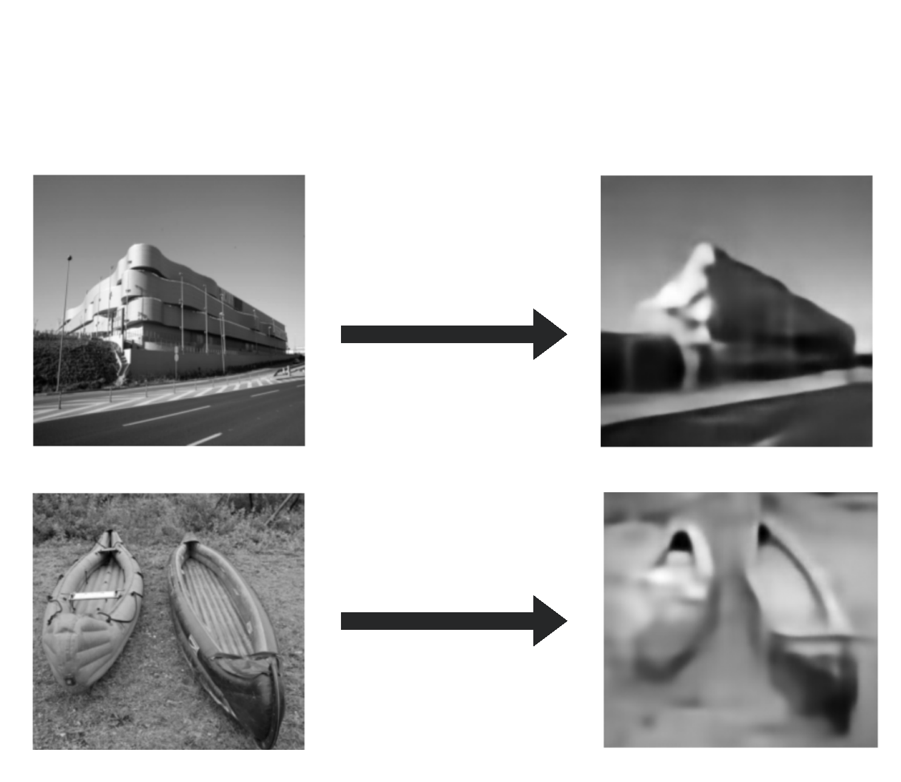

# Grayscale Image Colorization on Places365

**Author:** Luca Baratto

This project tackles the automatic colorization of grayscale images on the
**Places365** dataset. I implemented and compared three different approaches: a
**U-Net**, a **Variational Autoencoder (VAE)**, and a **multimodal Transformer**
that predicts a distribution over a quantized color palette.

## Table of Contents

1. [Introduction](#1-introduction)
2. [Dataset](#2-dataset)
3. [Color Representation](#3-color-representation)
4. [Methods](#4-methods)
   - [4.1 U-Net](#41-u-net)
   - [4.2 Variational Autoencoder](#42-variational-autoencoder)
   - [4.3 Transformer](#43-transformer)
5. [Results](#5-results)
   - [5.1 U-Net](#51-u-net)
   - [5.2 Variational Autoencoder](#52-variational-autoencoder)
   - [5.3 Transformer](#53-transformer)
6. [Project Structure](#6-project-structure)
7. [Installation and Usage](#7-installation-and-usage)
8. [Default Hyperparameters](#8-default-hyperparameters)
9. [Discussion and Limitations](#9-discussion-and-limitations)

## 1. Introduction

Colorization means recovering the two color (chrominance) channels of an image when
all you are given is its brightness. It is a genuinely ambiguous task: the same
grayscale photo can be colored in many plausible ways, so there is no single correct
answer. To explore the problem I built three different model families on top of one
shared Places365 pipeline and compared how they balance sharpness, color variety,
and training stability.

## 2. Dataset

The models are trained on [Places365-Standard](http://places2.csail.mit.edu/), a
large scene-recognition dataset with roughly 1.8M training images, 36.5k for
validation and 328.5k for testing. Every image is resized to `256x256` and
converted to the CIELAB color space, then split into the brightness channel `L`,
which is the input, and the color channels `a*b*`, which are the target. Both are
normalized to the `[-1, 1]` range.



The same loader (`utils.load_dataset`) can also read `celeba` and `cifar10`, which I
used for quick tests.

## 3. Color Representation

Every model works in **CIELAB** instead of RGB, for a practical reason. In RGB the
three channels (red, green, blue) are entangled, the distance between two colors
does not match how we actually perceive them, and the values depend on the display
device. Lab keeps brightness (`L`) separate from color (`a*`, `b*`), stays closer to
human perception, and is device-independent.

Because Lab isolates brightness, each model can take the known `L` channel as input
and only has to predict the two missing color channels. Those are then put back
together with `L` and converted to RGB for display.

## 4. Methods

### 4.1 U-Net

The U-Net is an encoder-decoder with skip connections that regresses the `a*b*`
channels straight from `L`. It is trained with a combined objective:

```
Loss = lambda * MAE + Perceptual
```

The perceptual term compares the VGG19 feature maps of the predicted and real images
(L1 distance), which pushes the network toward colors that look semantically right
rather than just numerically close.

- Model: `unet/colorization_model.py`
- Training: `unet/train_col_percept.py`

### 4.2 Variational Autoencoder

This is a convolutional VAE that compresses the grayscale image into a Gaussian
latent space and reconstructs it. Its loss is:

```
Loss = MSE + beta * KL Divergence
```

A linear warm-up on `beta` keeps the early epochs stable. The VAE works as a
colorization baseline on its own, but it also has a second job: its encoder is frozen
and reused as the semantic feature extractor for the Transformer.

- Model and training: `vae_transformer/autoencoder_module.py`

### 4.3 Transformer

Here colorization is reframed as a classification problem. The `a*b*` space is
quantized into a palette of `20 x 20 = 400` colors, and a Transformer encoder reads
the VAE latent vector and predicts a probability distribution over those 400 classes.
The target it learns to match is the normalized color histogram of the image, so the
training loss is:

```
Loss = KL Divergence
```

- Model and training: `vae_transformer/transformer_classifier.py`, which loads the
  pretrained VAE from `autoencoder_module.py` as a frozen encoder.

## 5. Results

For each method, below are a few qualitative examples (input, colorized output,
ground truth) together with its loss curve.

### 5.1 U-Net

Colorizes pixel by pixel and gives the sharpest, most faithful results of the three.




### 5.2 Variational Autoencoder

Only reconstructs the brightness channel, so its outputs come out smooth and blurry,
which is what an MSE + KL objective tends to produce.




### 5.3 Transformer

Predicts one global color distribution over the 400-color palette and paints the
image with the single most likely color. The overall tint is plausible, but there is
no spatial detail, because the model never predicts anything per pixel.


Below is the quantized `a*b*` color distribution of the dataset, which was used to
design the 400-color palette.


## 6. Project Structure

```
.
├── config.py                       # Shared hyperparameters and paths
├── utils.py                        # Dataset loading (Lab), transforms, visualization
├── requirements.txt
│
├── unet/                           # Method 1: U-Net
│   ├── colorization_model.py       #   ColorizationUNet architecture
│   └── train_col_percept.py        #   training with L1 + Perceptual loss
│
├── vae_transformer/                # Methods 2 and 3: VAE + Transformer
│   ├── autoencoder_module.py       #   VAE (model + training)
│   └── transformer_classifier.py   #   Transformer over the quantized palette (KL)
│
└── assets/                         # Figures used in this README
```

`config.py` and `utils.py` sit at the repository root because both methods share
them. Every training script adds that root to `PYTHONPATH` on its own, so you just
need to launch the scripts from the repository root.

## 7. Installation and Usage

```bash
# Install dependencies
pip install -r requirements.txt
```

Put the Places365-Standard dataset under `data/` (`data_large/`, `val_large/`,
`test_large/`), the layout `utils.load_dataset` expects. Then run everything from the
repository root:

```bash
# Method 1: U-Net (standalone)
python unet/train_col_percept.py

# Method 2: VAE (train this first, since it is the Transformer's encoder)
python vae_transformer/autoencoder_module.py

# Method 3: Transformer (needs the trained VAE)
python vae_transformer/transformer_classifier.py
```

Models, checkpoints and output images end up in `./results/` (`config.OUTPUT_DIR`),
and the dataset is chosen through `config.DATASET_NAME`.

## 8. Default Hyperparameters

| Model       | Key settings |
|-------------|--------------|
| Common      | image size `256x256`, latent dim `512` |
| U-Net       | epochs `100`, batch `16`, lr `2e-4`, `L1_LAMBDA = 100`, patience `10` |
| VAE         | epochs `100`, lr `1e-3`, `beta_final = 0.1`, KL warm-up `10`, patience `5` |
| Transformer | layers `8`, heads `8`, ff_dim `2048`, epochs `50`, lr `1e-6`, palette `20x20 = 400`, patience `5` |

All values live in `config.py`.

## 9. Discussion and Limitations

Of the three approaches, the **U-Net** gives the most faithful and detailed results,
because it predicts the color channels per pixel and keeps the spatial structure
through its skip connections. The **VAE** and the **Transformer** are weaker at
colorization by design: the VAE is really optimizing grayscale reconstruction, and
the Transformer only predicts one global color distribution. That is why their
outputs look blurry and flatly tinted, respectively. The main limitations:

- **Transformer, no spatial output.** It predicts a single global color distribution
  per image (from one latent vector), not a per-pixel map. At inference it paints the
  whole image with the most likely color, so it can guess the dominant palette of a
  scene but cannot place colors in the right spots. Taking the top-N colors instead
  of the top-1 would not help either, since the model has no spatial information at
  all. Proper colorization here would need a per-pixel output
  (`[num_classes, H, W]`), which means changing the architecture.
- **VAE, reconstruction only.** It is trained to rebuild the brightness channel, and
  an MSE + KL objective naturally gives smooth, blurry images. On its own it is just
  a grayscale autoencoder; in this project its real role is to be the frozen encoder
  behind the Transformer.
- **U-Net, regression bias and overfitting.** It is the only truly per-pixel
  colorizer and the sharpest of the three, but an L1/MAE loss tends to pull the
  predictions toward dull, average colors, and the validation loss starts drifting
  away from the training loss in the later epochs (mild overfitting).
- **No quantitative evaluation.** The comparison relies on qualitative examples and
  loss curves only; there are no PSNR/SSIM/LPIPS numbers. There are also no pretrained
  weights or a demo, so reproducing the results means training from scratch on a
  200k-image subset of Places365. (*Unfortunately, I lost those files while deleting the
  dataset, due to the amount of memory that was being used*) :)
  
