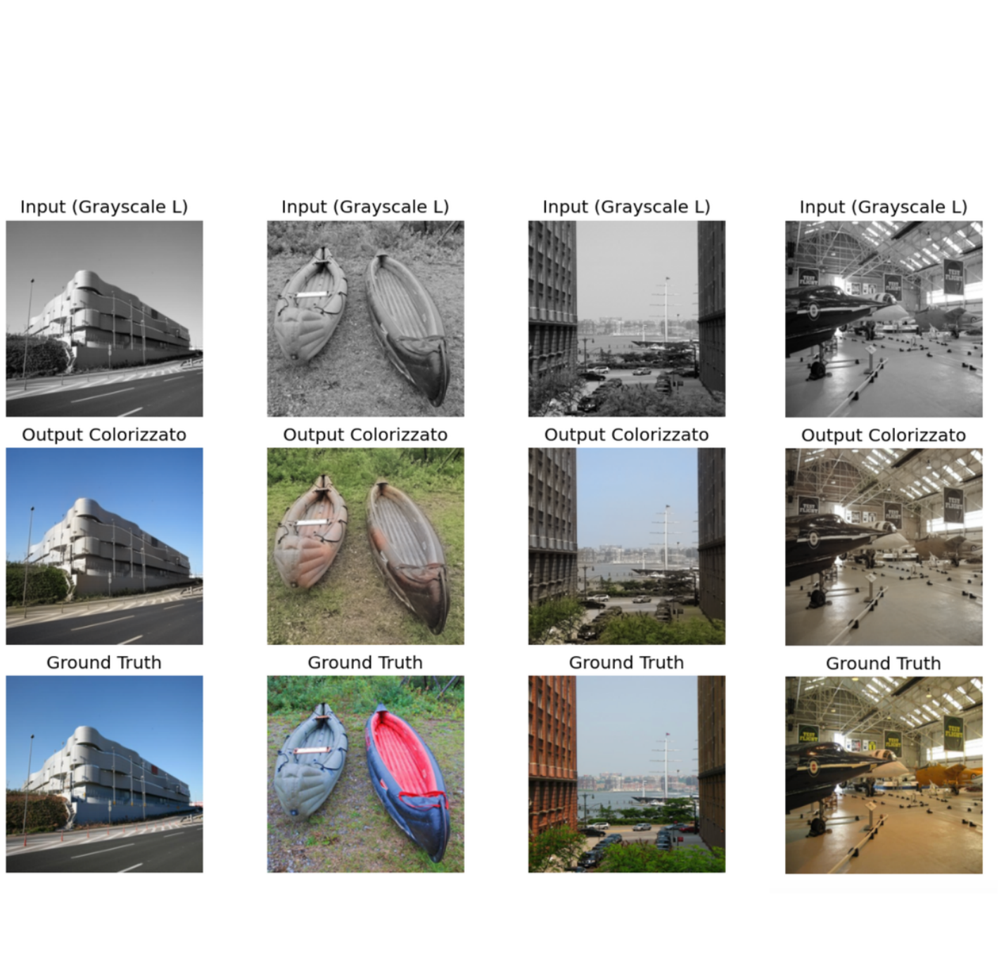
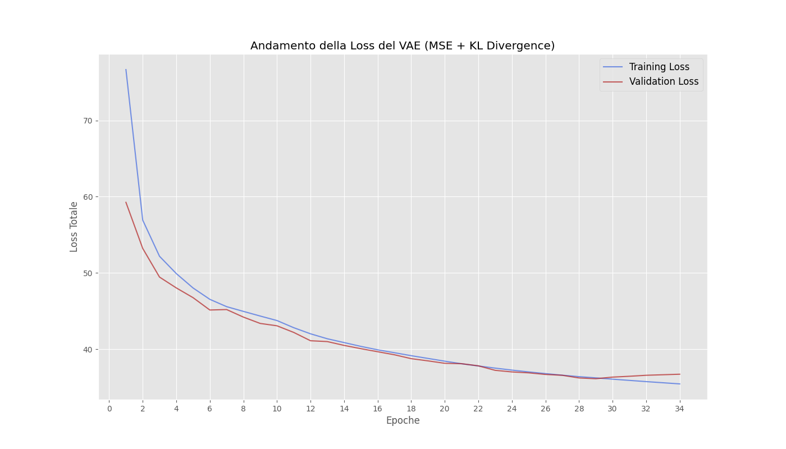
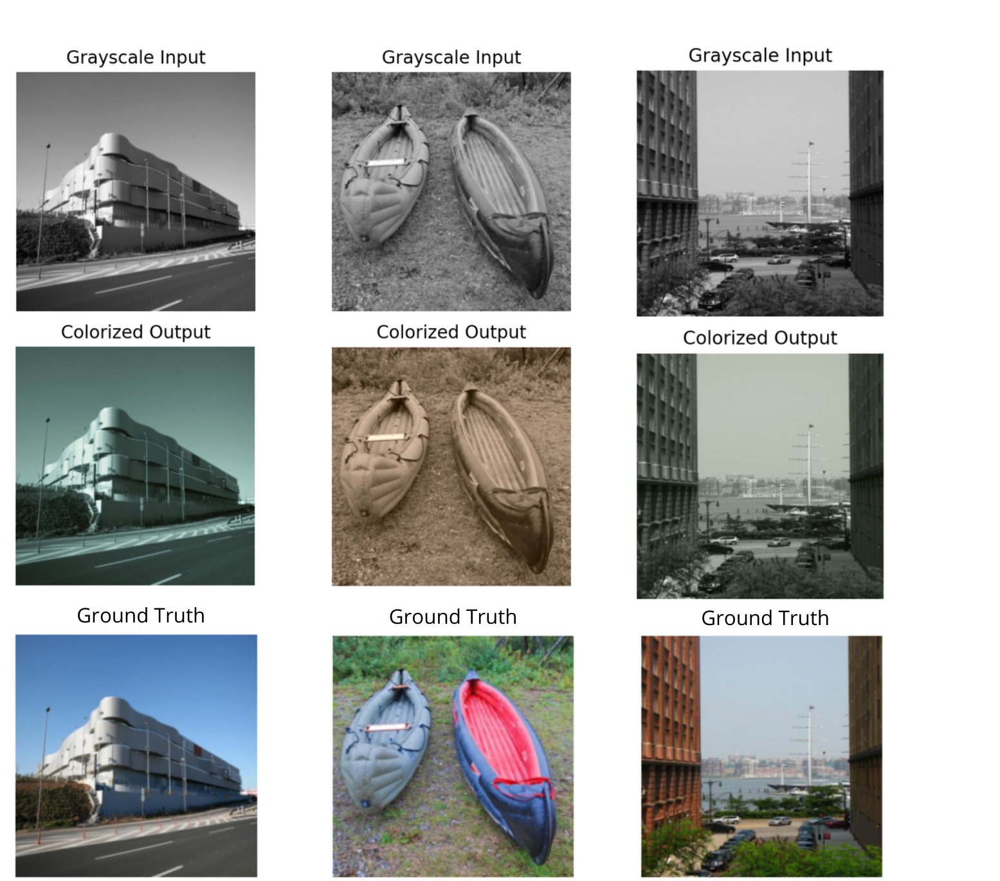
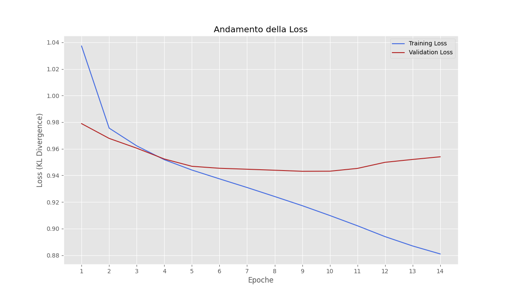
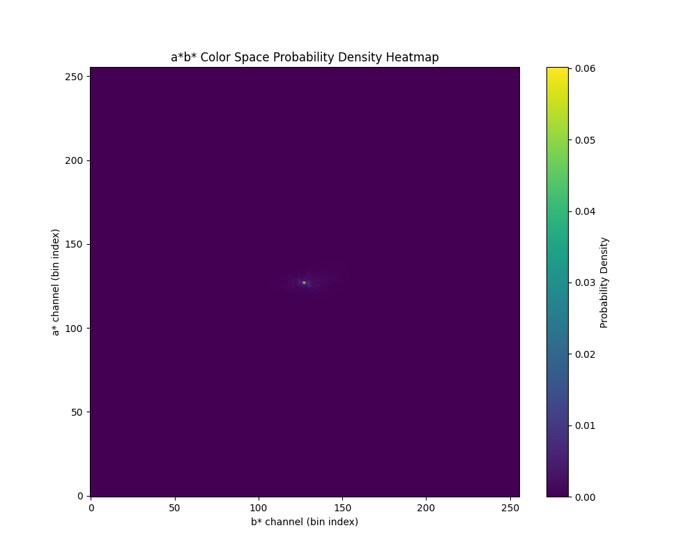

# Grayscale Image Colorization on Places365

**Author:** Luca Baratto

Automatic colorization of grayscale images on the **Places365** dataset. Three
different approaches are implemented and compared: a **U-Net**, a **Variational
Autoencoder (VAE)** and a **multimodal Transformer** that predicts a distribution
over a quantized color palette.

## Table of Contents

1. [Introduction](#1-introduction)
2. [Dataset](#2-dataset)
3. [Color Representation](#3-color-representation)
4. [Methods](#4-methods)
   - [4.1 U-Net](#41-u-net)
   - [4.2 Variational Autoencoder](#42-variational-autoencoder)
   - [4.3 Transformer](#43-transformer)
5. [Results](#5-results)
   - [5.1 U-Net](#51-u-net)
   - [5.2 Variational Autoencoder](#52-variational-autoencoder)
   - [5.3 Transformer](#53-transformer)
6. [Project Structure](#6-project-structure)
7. [Installation and Usage](#7-installation-and-usage)
8. [Default Hyperparameters](#8-default-hyperparameters)

## 1. Introduction

Image colorization is the task of predicting the two chrominance channels of an
image given only its luminance (grayscale) channel. The problem is inherently
*multimodal*: a single grayscale input is compatible with many plausible
colorizations. This repository explores three model families that trade off
sharpness, diversity and training stability in different ways, all trained and
evaluated on the same Places365 pipeline.

## 2. Dataset

[Places365-Standard](http://places2.csail.mit.edu/) is a large-scale scene-centric
dataset (~1.8M training images, 36.5k validation, 328.5k test). Images are resized
to `256x256`, converted to the CIELAB color space and split into the luminance
input `L` and the chrominance target `a*b*`, both normalized to `[-1, 1]`.


The data loader (`utils.load_dataset`) also supports `celeba` and `cifar10` for
quick experimentation.

## 3. Color Representation

All models operate in the **CIELAB** color space rather than RGB:

- **RGB** mixes red, green and blue; distances between colors are non-uniform and
  the representation is device-dependent.
- **Lab** separates luminance (`L`) from chrominance (`a*`, `b*`), is perceptually
  more uniform and device-independent.

Working in Lab lets the models take the known `L` channel as input and predict only
the two missing chrominance channels, which are then recombined with `L` and
converted back to RGB.

## 4. Methods

### 4.1 U-Net

An encoder-decoder with skip connections that regresses the `a*b*` channels
directly from `L`. It is trained with a combined loss:

```
Loss = lambda * MAE + Perceptual
```

where the perceptual term is the L1 distance between VGG19 feature maps of the
predicted and ground-truth images, encouraging semantically plausible colors.

- Model: `unet/colorization_model.py`
- Training: `unet/train_col_percept.py`

### 4.2 Variational Autoencoder

A convolutional VAE that encodes the grayscale image into a Gaussian latent space
and reconstructs it. It is trained with:

```
Loss = MSE + beta * KL Divergence
```

with a linear `beta` warm-up to stabilize training. Besides being a colorization
baseline, its encoder is reused as a frozen semantic feature extractor for the
Transformer.

- Model and training: `vae_transformer/autoencoder_module.py`

### 4.3 Transformer

The chrominance space is quantized into a palette of `20 x 20 = 400` colors,
turning colorization into a classification problem. A Transformer encoder takes the
VAE latent vector and predicts a probability distribution over the 400 color
classes. The ground-truth target is the normalized color histogram of the image,
and the model is trained with:

```
Loss = KL Divergence
```

- Model and training: `vae_transformer/transformer_classifier.py` (uses the
  pretrained VAE from `autoencoder_module.py` as a frozen encoder).

## 5. Results

Qualitative results (input, colorized output, ground truth) and loss curves for
each method.

### 5.1 U-Net

Colorizes the image pixel by pixel and produces the sharpest, most faithful
results.




### 5.2 Variational Autoencoder

Reconstructs the luminance channel; outputs are smooth and blurry, as expected
from an MSE + KL objective.




### 5.3 Transformer

Predicts a global color distribution over the 400-color palette and applies the
most likely color as a uniform tint. Results are globally plausible but not
spatially detailed, since the model has no per-pixel output.





The quantized `a*b*` distribution of the dataset, used to design the 400-color
palette:



## 6. Project Structure

```
.
├── config.py                       # Shared hyperparameters and paths
├── utils.py                        # Dataset loading (Lab), transforms, visualization
├── requirements.txt
│
├── unet/                           # Method 1 - U-Net
│   ├── colorization_model.py       #   ColorizationUNet architecture
│   └── train_col_percept.py        #   training with L1 + Perceptual loss
│
├── vae_transformer/                # Methods 2 and 3 - VAE + Transformer
│   ├── autoencoder_module.py       #   VAE (model + training)
│   └── transformer_classifier.py   #   Transformer over the quantized palette (KL)
│
└── assets/                         # Figures used in this README
```

`config.py` and `utils.py` live at the repository root because they are shared by
both methods. Each training script adds the root to `PYTHONPATH` automatically, so
scripts must be launched from the repository root.

## 7. Installation and Usage

```bash
# Install dependencies
pip install -r requirements.txt
```

Place the Places365-Standard dataset under `data/` (`data_large/`, `val_large/`,
`test_large/`) as expected by `utils.load_dataset`. Run every command from the
repository root:

```bash
# Method 1 - U-Net (standalone)
python unet/train_col_percept.py

# Method 2 - VAE (must be trained first: it is the Transformer's encoder)
python vae_transformer/autoencoder_module.py

# Method 3 - Transformer (requires the trained VAE)
python vae_transformer/transformer_classifier.py
```

Models, checkpoints and output images are written to `./results/`
(`config.OUTPUT_DIR`). The dataset is selected through `config.DATASET_NAME`.

## 8. Default Hyperparameters

| Model       | Key settings |
|-------------|--------------|
| Common      | image size `256x256`, latent dim `512` |
| U-Net       | epochs `100`, batch `16`, lr `2e-4`, `L1_LAMBDA = 100`, patience `10` |
| VAE         | epochs `100`, lr `1e-3`, `beta_final = 0.1`, KL warm-up `10`, patience `5` |
| Transformer | layers `8`, heads `8`, ff_dim `2048`, epochs `50`, lr `1e-6`, palette `20x20 = 400`, patience `5` |

All values are defined in `config.py`.
